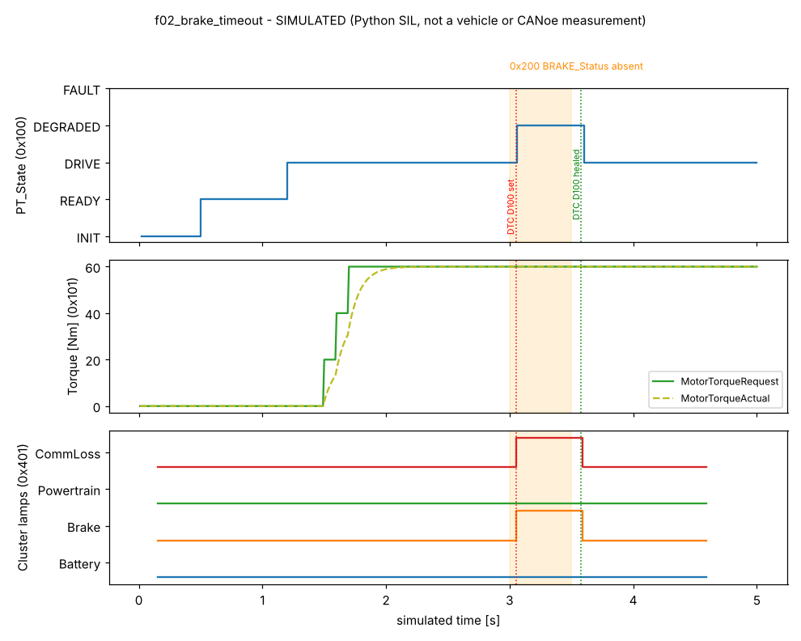

# Automotive Multi-ECU CAN Network, Diagnostics and Validation Platform


**PROJECT 1 of 7** in an automotive embedded-systems portfolio (ENSA Khouribga, target: 2027 final-year internship).

A virtual (SIL-style) vehicle with six nodes on two CAN networks, a frozen CAN database,
CAPL simulation for Vector CANoe/CANalyzer, an academic UDS/OBD-II-inspired diagnostic subset,
fault injection, and a Python log-analysis/test layer.

> **Honesty statement.** Everything here is virtual/software-in-the-loop. Nothing has been validated on a
> real vehicle or ECU. Every test case carries an explicit status (see `tests/test_matrix.md`);
> no result is reported unless it was actually executed.
> This project is **not** AUTOSAR and does **not** claim ISO 14229 / ISO 26262 conformance.
> *AUTOSAR-inspired concepts are planned for future projects.*

## Results at a glance (SIMULATED - Python SIL, not a vehicle, not CANoe)
Every push re-runs 34 tests and regenerates these figures (CI badge above). All faults are injected on the bus; ECU code has no test hooks.
Example - **F02: BRAKE_Status (0x200) absent for 500 ms**: the timeout (60 ms) is detected at 3050 ms, DTC U1100 is set, the powertrain degrades and the cluster raises its lamps; after the message returns the DTC heals (3580 ms) and the powertrain recovers.



| Scenario | Result (simulated) |
|---|---|
| F01 single frame lost | no DTC (debounce works) |
| F02 brake timeout | DTC D100 set @ 3050 ms, healed @ 3580 ms, PT DEGRADED |
| F03 invalid speed | DTC 5201 @ 3020 ms; PT degrades only after the 500 ms hold; cluster shows dashes |
| F04 voltage 600 V | DTC 1301 @ 3100 ms, value rejected, PT DEGRADED |
| F05 BMS unavailable | DTC D101 @ 3110 ms, PT FAULT, torque 0; slow heal (~2.5 s, finding in docs/10) |
| F07 counter / CRC faults | DTC D110 / D111 @ 3020 ms after 3 bad frames |
Full table and all figures: [`docs/sil_results.md`](docs/sil_results.md) - test list with real PASS status: [`tests/test_matrix.md`](tests/test_matrix.md).
What is *not* proven: the CAPL files have not been compiled or run in CANoe (no licence yet), and nothing was tested on hardware.

## Status (Phase 2 delivered)
| Area | State |
|---|---|
| Requirements, architecture, CAN matrix, DBC spec | done (docs 01-05) |
| `vehicle_v1_0.dbc` (generated from `scripts/can_matrix.py`) | done, statically validated with `cantools` |
| E2E (counter + CRC-8) Python reference + unit tests | done, executed |
| CAPL: common libs (E2E, DTC store, supervision), POWERTRAIN/BRAKE/BMS/CLUSTER nodes | written, **not yet compiled/run in CANoe** (bring-up: `tests/phase2_bringup.md`) |
| **Python SIL** (`python/sil`): ECUs + fault scenarios, no Vector tools | done, 10 scenario tests executed (simulated) |
| Python: ASC log parser, periodicity/missing-message/E2E analysis | done, tested on synthetic logs |
| Diagnostic / fault-injection / test specs | done (docs 06-08), designed only |
| Gateway CAPL, diagnostics CAPL, injector, plots/report | planned (Phases 3-6) |

## Quick start
```bash
python -m venv .venv && source .venv/bin/activate
pip install -r requirements.txt
python scripts/generate_dbc.py        # regenerate DBC/CSV/MD from the matrix source
python scripts/generate_dbc.py --check  # fail if committed files are stale
pytest -q                              # DBC, E2E, log-analysis and SIL scenario tests (34)
python python/main.py sil all          # run the Python SIL scenarios (no CANoe needed)
python python/main.py periodicity <log.asc>   # analyse a CANoe ASC export
```

## Layout
```
docs/           01..12 engineering documents (+ 00 overview/roadmap)
can_database/   vehicle_v1_0.dbc, can_matrix.csv, can_matrix.md (generated)
capl/           CAPL sources (common/*.cin + one node per ECU)
canoe/          CANoe configuration guide (no binary .cfg committed)
canalyzer/      CANalyzer analysis workflow
diagnostic/     pointer to diagnostic specification
python/         analysis layer (can_analysis, signal_processing, diagnostics, visualization, reporting)
tests/          unit tests + test matrix
results/        real results only (empty until executed)
scripts/        can_matrix.py (single source of truth), generate_dbc.py
```

## Frozen interfaces (reused by Projects 2-7)
ECU names, CAN IDs, signal names and the E2E profile are frozen at **DBC v1.0.0**.
Changes follow the policy in `docs/04_dbc_specification.md` (additive only; no renumbering).

## References (conceptual alignment only)
Vector CANoe <https://www.vector.com/fr/product/canoe/> - Vector CANalyzer <https://www.vector.com/fr/product/canalyzer/> -
AUTOSAR <https://www.autosar.org/> - MathWorks Model-Based Design <https://www.mathworks.com/help/simulink/gs/model-based-design.html> -
ISO 26262 <https://www.iso.org/standard/90020.html>
