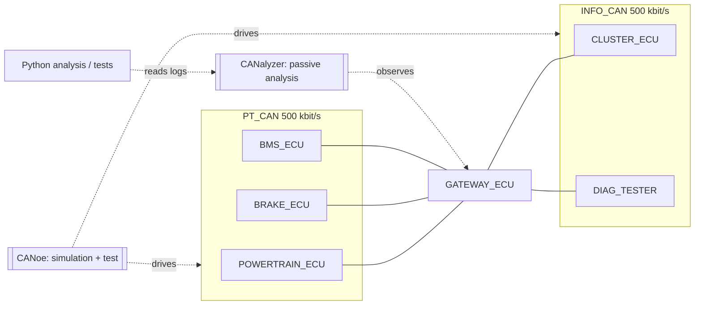
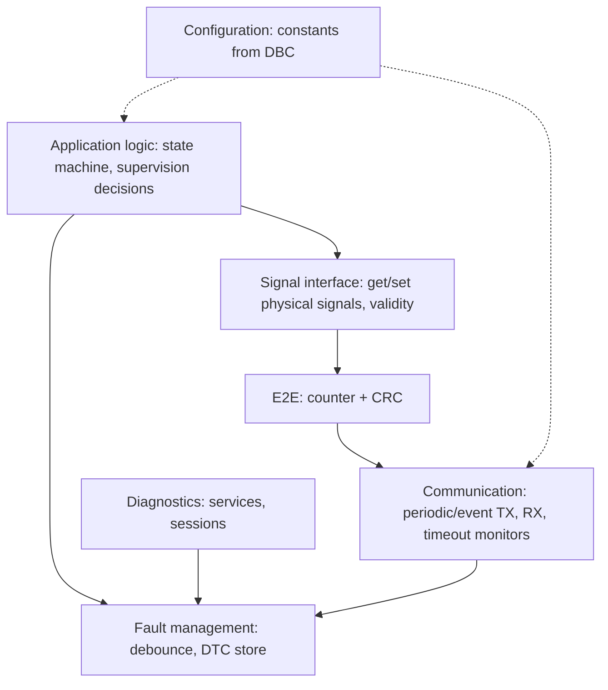

# 02 - System Architecture

## Frozen decisions (v1.0)
| Decision | Choice | Why |
|---|---|---|
| Networks | `PT_CAN` (POWERTRAIN, BRAKE, BMS, GATEWAY) and `INFO_CAN` (GATEWAY, CLUSTER, DIAG_TESTER), both 500 kbit/s | Two domains make the gateway meaningful; diagnostic port isolated from powertrain traffic. |
| One DBC for both buses | `vehicle_v1_0.dbc`, assigned to both CANoe networks | Same contract everywhere; origin bus stored as attribute `OriginBus`. |
| Diagnostic IDs | 0x700 functional; 0x701-0x705 physical request; response = request + 8 | Improves the proposal (single 0x700/0x708 pair) by giving per-ECU addressing; 0x708 is reserved. |
| `VehicleSpeed` sender | BRAKE_ECU (0x201 BRAKE_VehicleDynamics) | Wheel speeds live in the brake/ESC domain; reused by Project 3. |
| Protection | E2E profile VEH-E2E-1 (counter + CRC-8) on all application messages | Enables counter/checksum faults and Project 6 safety work. |

## Topology

## Components and responsibilities
| Component | Responsibility |
|---|---|
| POWERTRAIN_ECU | Drive state machine, torque/speed publication; consumes brake and battery status (Phase 2). |
| BRAKE_ECU | Brake status, wheel-speed-derived `VehicleSpeed`, acceleration, yaw rate. |
| BMS_ECU | Battery state, SOC/SOH, voltage/current/temperature, fault events. |
| CLUSTER_ECU | Displays routed data, supervises timeouts, raises warning lamps. |
| GATEWAY_ECU | Allow-list routing, latency, unknown-ID filtering, bus-load/health reporting, diagnostic routing. |
| DIAG_TESTER | Sends UDS-subset/OBD-II-inspired requests, evaluates responses. |
| Fault injector (separate node) | Suppresses, corrupts or delays traffic on command (Phase 4). |
| CANoe | Runs nodes, panels, test modules, logging. Requires a Vector licence. |
| CANalyzer | Trace, statistics, filtering, replay. |
| Python | Log parsing (`cantools`), frequency/missing-message/E2E analysis, plots, report. Works without Vector tools on exported logs. |

## Layered software architecture (per ECU, CAPL now / C later)

These separations are what Projects 2 and 4 will map to MCAL/BSW/RTE-style modules.
**This project is not AUTOSAR. AUTOSAR-inspired concepts are planned for future projects.**

## Reproducibility tiers
1. **Tier A (no Vector licence):** DBC + Python tests + log analysis + **Python SIL** (`python/sil`, simulated-time port of the ECUs, fault scenarios). Fully executed today.
2. **Tier B (CANoe/CANalyzer licence, virtual channels):** CAPL simulation, panels, test modules. Requires a licence or demo edition - check Vector's current offers; nothing here assumes one is available.
3. **Tier C (hardware):** optional STM32/ESP32 CAN nodes (Project 2). Not part of Project 1 results.
