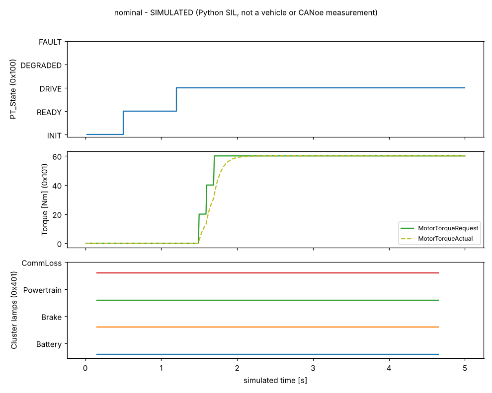
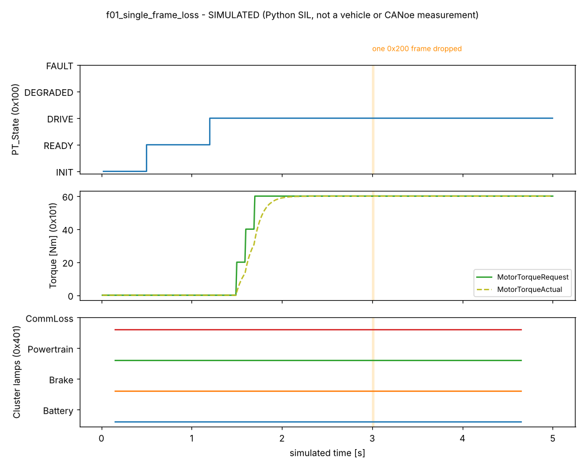
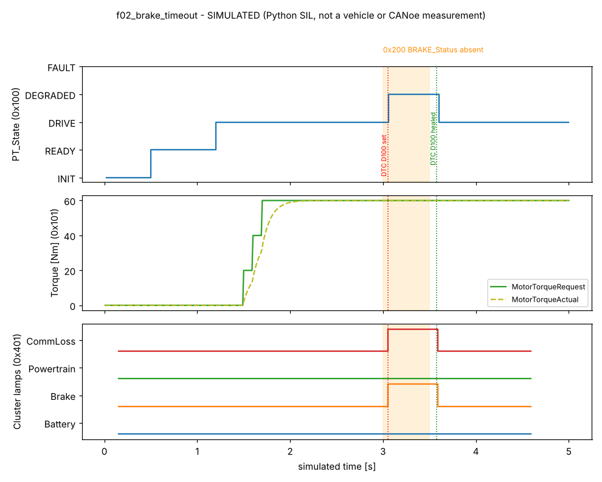
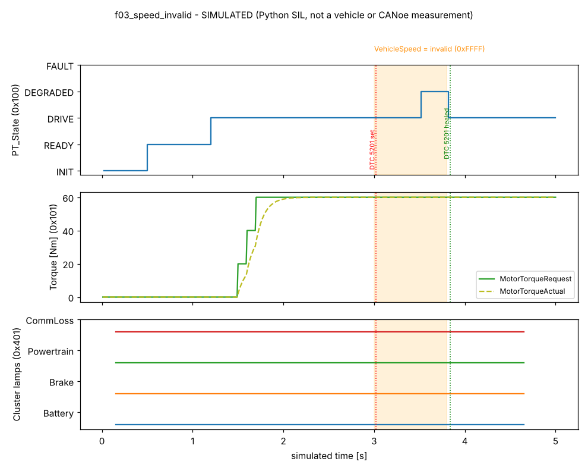
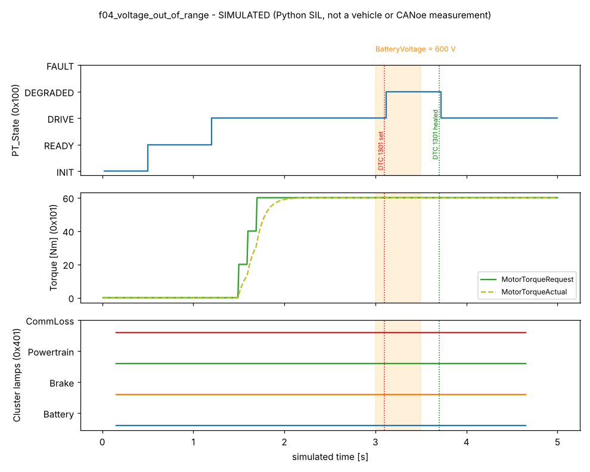
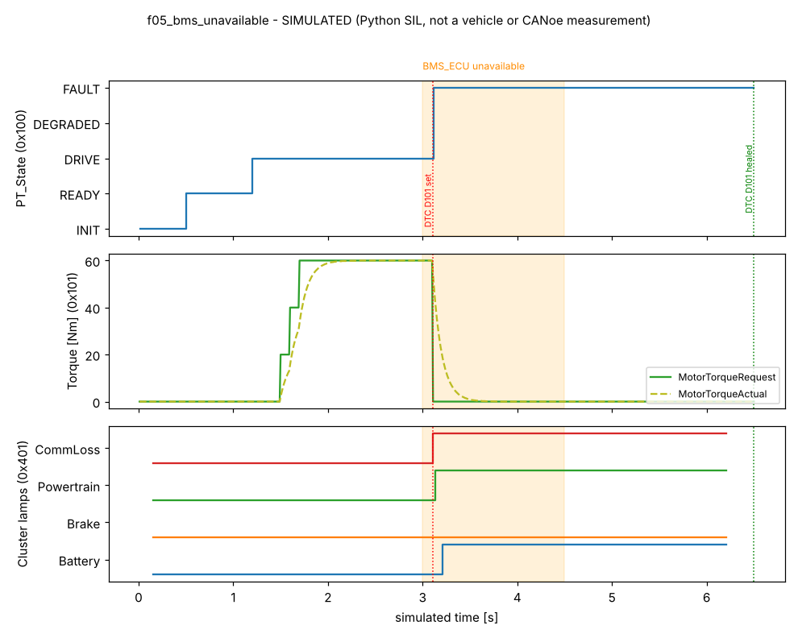
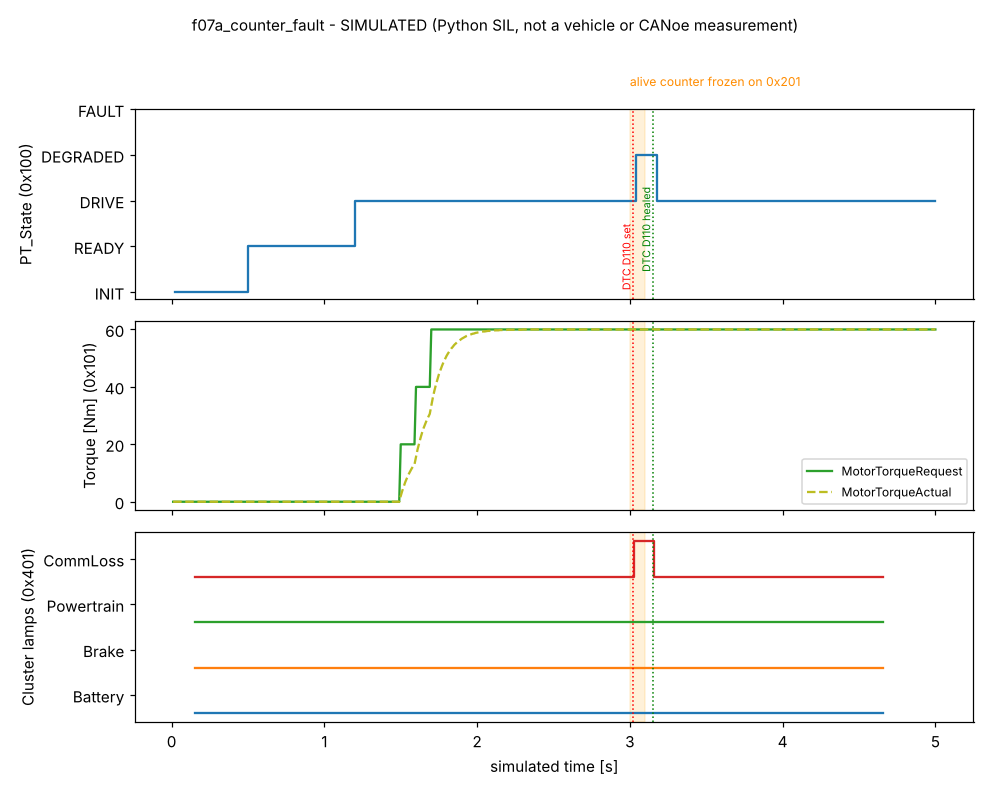
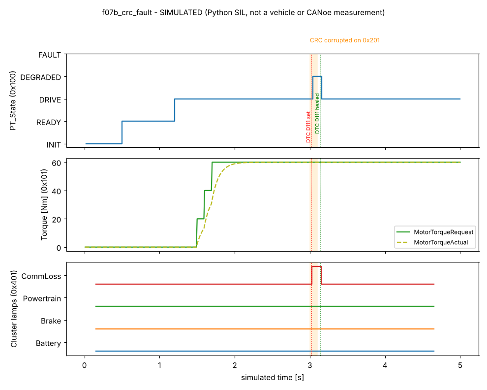
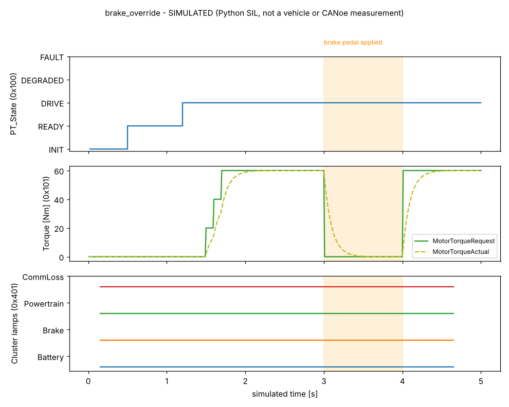

# Python SIL results (SIMULATED)

Generated by `python python/main.py sil-report`. Every number below comes from an executed run of the Python port of the ECU design on a simulated-time bus. These are **not** CANoe measurements and **not** vehicle tests.

| Scenario | Fault | DTC events (first set / healed, powertrain ECU) |
|---|---|---|
| `nominal` | No fault; drive started at 1.2 s, torque request 60 Nm. | none |
| `f01_single_frame_loss` | F01 - one BRAKE_Status frame lost (below the 60 ms timeout). | none |
| `f02_brake_timeout` | F02 - BRAKE_Status absent for 500 ms. | DTC D100 set @ 3050 ms; DTC D100 healed @ 3580 ms |
| `f03_speed_invalid` | F03 - VehicleSpeed carries its invalid value for 800 ms. | DTC 5201 set @ 3020 ms; DTC 5201 healed @ 3840 ms |
| `f04_voltage_out_of_range` | F04 - BatteryVoltage 600 V (range 0-500 V) for 500 ms. | DTC 1301 set @ 3100 ms; DTC 1301 healed @ 3700 ms |
| `f05_bms_unavailable` | F05 - BMS_ECU unavailable for 1.5 s. | DTC D101 set @ 3110 ms; DTC D101 healed @ 6500 ms |
| `f07a_counter_fault` | F07a - alive counter frozen on VehicleDynamics for 100 ms. | DTC D110 set @ 3020 ms; DTC D110 healed @ 3150 ms |
| `f07b_crc_fault` | F07b - CRC corrupted on VehicleDynamics for 100 ms. | DTC D111 set @ 3020 ms; DTC D111 healed @ 3140 ms |
| `brake_override` | Brake pedal applied 3.0-4.0 s while 60 Nm is requested. | none |

## nominal
No fault; drive started at 1.2 s, torque request 60 Nm.

## f01_single_frame_loss
F01 - one BRAKE_Status frame lost (below the 60 ms timeout).

## f02_brake_timeout
F02 - BRAKE_Status absent for 500 ms.

## f03_speed_invalid
F03 - VehicleSpeed carries its invalid value for 800 ms.

## f04_voltage_out_of_range
F04 - BatteryVoltage 600 V (range 0-500 V) for 500 ms.

## f05_bms_unavailable
F05 - BMS_ECU unavailable for 1.5 s.

## f07a_counter_fault
F07a - alive counter frozen on VehicleDynamics for 100 ms.

## f07b_crc_fault
F07b - CRC corrupted on VehicleDynamics for 100 ms.

## brake_override
Brake pedal applied 3.0-4.0 s while 60 Nm is requested.

